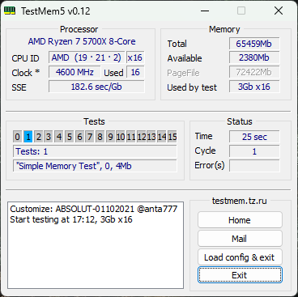

# TMR (Test Memory R)

**TMR** is short for **Test Memory R**, the R for Rust. It's a remake of TM5 (TestMem5 by Serj,
<https://testmem.tz.ru>), the memory tester highly acclaimed by memory overclockers. I contacted Serj,
who was kind enough to fix a broken link on his website that gave me TM5's original assembly source.
I then used Claude AI (with a little bit of Astra/Codex) to reimplement TM5 in Rust for modern Windows
and hardware, with DDR5 systems in mind.

## Key changes from TM5

- **Fixed allocations instead of a sliding window.** TM5 slides an AWE window over the memory it
  tests; TMR gives each thread its own fixed allocation, with native 64-bit addressing.
- **Huge (1 GB) and large (2 MB) pages**, locked in memory (non-pageable). Both are faster than
  regular 4 KB pages. No driver: TMR runs in user mode, and `tmr.exe --setup-large-pages` (elevated)
  grants the privilege they need once.
- **Wider SIMD:** each test comes in 128-bit (SSE4.2), 256-bit (AVX2) and 512-bit (AVX-512) widths,
  the widest the CPU has by default (`width=` picks one). AMX/ACE are next to look at.
- **TM5 configs still work:** TMR loads TM5 `.cfg` files and runs the equivalent tests.
- **TM5's test 0 becomes the seal:** all memory is sealed at the start of a cycle and checked at its
  end, and each block a checking test works on is checked before and resealed after it, so an error
  in memory no test is touching is still caught.
- **Errors say more:** a failed check is rescanned to tell a misread from a wrong stored value,
  failures are counted by bit position (one bit failing everywhere points at one data line), and
  Windows' hardware error log (WHEA) is watched for errors the tests can't see themselves.
- **Built for today's CPUs:** threads are pinned to physical cores and take their memory from their
  own NUMA node while it has room, CPUs beyond 64 (processor groups) are used, and checks can bypass the caches
  (non-temporal stores, CLFLUSHOPT) so they read DRAM.
- **Patterns aimed at the memory bus**, alongside TM5's. A switching family inverts each beat of a
  burst at the bus's own width, so every data line toggles on every transfer, the most switching
  noise the data can make: 64-bit for DDR4 and earlier, 32-bit for DDR5's subchannels, 16-bit for
  LPDDR4/5, picked from the memory type SMBIOS reports, and models of LPDDR6's 12-bit and DDR6's
  24-bit, chosen with `beat=`. A random family feeds every line every short bit sequence, which DDR5's receive
  equalisers react to. Both aim to make a marginal overclock fail sooner.
- **Built-in test plans** (`plan=`; `stability` by default), **results as JSON** saved during the
  run and comparable between runs, and a console (CLI) and, optionally, a window (GUI, WinUI 3
  through `windows-reactor`) in one `tmr.exe`.

## Windows support

`tmr.exe` opens its window when double-clicked, and runs in the console when started from a shell,
a script or a remote session; `--gui` and `--cli` choose explicitly. The window is built only with
`cargo build --release --features tmr-app/gui`; a plain `cargo build --release` is the console alone.

| Windows | Build | Console (CLI) | Window (GUI) |
|---|---|---|---|
| Server 2022 | 20348 | Yes | No: the console runs instead, and a double-click opens it in its own console window |
| Windows 11 21H2, 22H2, 23H2 | 22000–26099 | Yes | Yes, but a double-click flashes a console window briefly before the window opens |
| Windows 11 24H2 and later, Server 2025 | 26100 and later | Yes | Yes, fully supported |

The window also needs the Windows App Runtime 2.x installed; when it is missing, TMR shows a dialog
with the download link. Older Windows (Windows 10, Server 2019) is not supported. The CPU needs AVX2
and CLFLUSHOPT (Intel Skylake or AMD Zen and later); TMR checks at startup.

## License

This project is licensed under either of:

- MIT License ([LICENSE-MIT](./LICENSE-MIT))
- Apache 2.0 License ([LICENSE-APACHE](./LICENSE-APACHE))

at your option.

## Credits

TMR was inspired by TM5, and wouldn't exist without it. Many thanks to Serj for his kind donation of
TM5 to the community.

- Serj's work: <https://testmem.tz.ru>
- TM5 page: <https://testmem.tz.ru/testmem5.htm>

